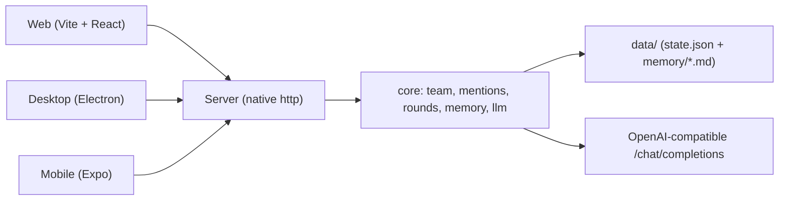

# Architecture

## Overview

3end-bot is a standalone backend plus three clients. The backend owns all bot logic and
state; each client is a view. There is no shared code with any other project.



## Packages

| Package | Responsibility |
| --- | --- |
| `packages/core` | Domain logic. `team.ts` (store), `mentions.ts` (`@` parsing), `orchestrator.ts` (group rounds + memory review), `memory.ts` (Markdown memory), `llm.ts` (OpenAI-compatible client + mock), `types.ts`. |
| `packages/server` | Native `node:http` server. REST routes, static serving of the web build, `.env` loading. No web framework. |
| `packages/web` | Vite + React client. Sidebar of groups and bots, chat timeline, composer with `@` autocomplete. Imports `@3end/core/mentions` and `@3end/core/types` only. |
| `packages/desktop` | Electron shell. Spawns the server, waits for `/api/health`, loads the web URL. |
| `packages/mobile` | Expo / React Native client. Same HTTP API as web. |

## Group round model

A group chat is one shared ordered conversation. For each user message:

1. The user message is appended to the room log.
2. Speakers are chosen: `@Name` in the message picks members; otherwise the admin answers.
3. Members speak one at a time. Each sees the recent transcript plus team and personal
   memory. A reply of `[PASS]` produces no answer.
4. An `@Name` inside a bot reply queues that member for the next turn.
5. The round is bounded (`MAX_TURNS`), so a loop cannot run away.

`mentions.ts` is a pure function shared by the engine and the web client, so what the user
sees called (`@Name` highlighted in the composer) is exactly what the engine calls.

## Message protocol

Room messages are `{ id, roomId, authorId, authorName, text, kind, ts }` with
`kind: 'message' | 'pass' | 'system'`. A room is a group id or `dm:<botId>`. This shape is
what all three clients render; adding streaming later means emitting the same shape
incrementally over SSE without changing the clients' data model.

## Memory

Plain Markdown, one entry per line, ending in `[source: …; added: …]`. Two scopes:
`team` (shared) and one per bot. The current implementation reviews a turn for
preference-like statements and stores them; entries are capped and secret-looking text is
refused. See `packages/core/src/memory.ts`.

## Extension points

- **Streaming**: wrap `runGroupTurn` with SSE; each appended `RoomMessage` is a frame.
- **More ends**: any client that calls the REST API is a new end; the engine does not change.
- **Persistence of history**: `TeamStore` keeps a JSON `state.json`; the room log can be
  moved to the same file or SQLite behind `appendMessage` / `messages`.
- **Real model routing per bot**: `Bot.model` overrides the default model per turn.

## Running

```sh
npm install
npm run build      # web client -> packages/web/dist
npm start          # server serves API + web on :8787
```

Dev loop: `npm run dev` (server + Vite HMR). Desktop: `cd packages/desktop && npm install
&& npm start`. Mobile: `cd packages/mobile && npm install && npm start`.
